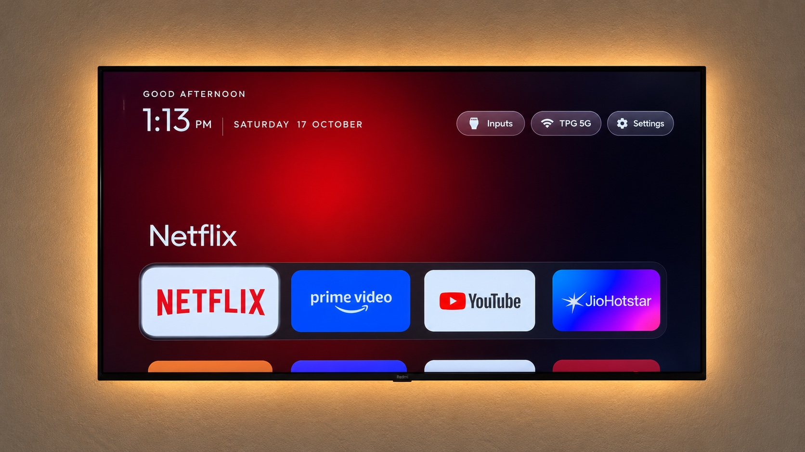

# Claude Code ile TV'nin ana ekranını temizle

Android TV ve Google TV'deki reklamlı ana ekranı, üreticinin takip servislerini ve kullanmadığın hazır uygulamaları Claude Code'a kapattırmanın Türkçe rehberi. İşi [CleanYourTV](https://github.com/Gathin23/cleanyourtv) reposu yapıyor. Bu rehberde reponun nasıl çalıştığını, senin hangi adımları atacağını ve beğenmezsen nasıl geri alacağını bulacaksın.

YouTube gibi uygulamaların kendi içindeki reklamlar bununla gitmiyor. Değişen, TV'nin ana ekranı ve arka planda çalışan servisler ([Sınırlar](#sınırlar)).

Reel'den geldiysen: videoda anlattığımız repo bu, adımlar aşağıda.

| Önce | Sonra |
|---|---|
|  |  |

Bu iki fotoğraf CleanYourTV projesinin kendi örneği, bizim TV'miz değil. Bizim denememizin nerede durduğu [aşağıda](#bizim-denememiz).

## Kısaca

Süreç, projenin anlattığı haliyle:

1. TV'nin ayarlarından USB hata ayıklamayı açıyorsun.
2. CleanYourTV reposunu, TV ile aynı Wi-Fi'daki bilgisayarına indiriyorsun.
3. O klasörde Claude Code'u açıp `@PROMPT.md uygula. TV modelim: <model>` yazıyorsun.
4. Claude TV'ye ağ üzerinden bağlanıyor ve önce mevcut durumu yedekliyor. Ardından reklam ve takip servislerini kapatıp Apple TV'ye benzeyen sade bir ana ekran kuruyor. Kullandığın uygulamalara dokunmadan önce sana soruyor.
5. Beğenmezsen tek komutla eski haline dönüyor.

Projenin README'sine göre repo indirildikten sonra iş yaklaşık 15 dakika sürüyor.

## İçindekiler

| | Ne var |
|---|---|
| [nasil-calisir.md](nasil-calisir.md) | Perde arkası: ADB bağlantısı, paket kapatma, geri alma kaydı, yeni ana ekran |
| [promptlar/](promptlar/) | Başlatma, bitince ADB'yi kapatma, geri alma ve güncelleme sonrası için promptlar ([liste](#promptlar)) |
| [ornek/](ornek/) | 24 Ekim'de Beko modeliyle yaptığımız gerçek Claude Code kaydı |

## 0. Önce bak: TV'n uygun mu?

| TV'n | Ne oluyor |
|---|---|
| Android TV, Google TV | Hem temizlik hem yeni ana ekran. Yeni ana ekran için TV'de en az Android 8.0 gerekiyor, bazı Çin pazarı TCL'ler de kurdurmuyor |
| Fire TV | Sadece temizlik. Fire OS ana ekranı başka uygulamaya bırakmıyor |
| Samsung (Tizen), LG (webOS), Roku, Vizio, Hisense VIDAA | Çalışmıyor, bu sistemlerde ADB yok. Takibi kumandayla kapatmanın yolu: [cleanyour.tv/not-android](https://cleanyour.tv/not-android) |

TV'nin Android olup olmadığını anlamak için ana ekranda Google Play Store'a ya da ayarlarda "Android TV", "Google TV" yazısına bak. Model numarası TV'nin arkasındaki etikette ve ayarlardaki "Hakkında" sayfasında yazıyor.

Repoda katkıcıların kendi TV'lerinde test ettiği hazır listeler var. 28 Ekim 2026'da 93 markadan 345 model vardı. Reel'de 280 demiştik, o sayı 24 Ekim'deki listeye aitti. Modelini [cleanyour.tv/tvs](https://cleanyour.tv/tvs) adresinde arayabilirsin. Türkiye'den eklenenler:

| Model | Hazır liste |
|---|---|
| Beko B43B880B (Android TV 11) | [beko-b43b880b](https://github.com/Gathin23/cleanyourtv/tree/main/examples/beko-b43b880b) |
| Grundig 50 GFU 7850 B (Android TV 11) | [grundig-50gfu7850b](https://github.com/Gathin23/cleanyourtv/tree/main/examples/grundig-50gfu7850b) |
| Grundig Android UHD TV (Android TV 14) | [grundig-kunyang](https://github.com/Gathin23/cleanyourtv/tree/main/examples/grundig-kunyang) |
| TCL 50P615 (Yunanistan ve Türkiye, Android TV 11) | [tcl-50p615](https://github.com/Gathin23/cleanyourtv/tree/main/examples/tcl-50p615) |
| TCL 55C728 (Google TV 11, 65C735 listesinin içinde) | [tcl-65c735](https://github.com/Gathin23/cleanyourtv/tree/main/examples/tcl-65c735) |
| Turkcell TV+ 4K Box (Android TV 10) | [turkcell-tv-plus-4k-box-dv6069y](https://github.com/Gathin23/cleanyourtv/tree/main/examples/turkcell-tv-plus-4k-box-dv6069y) |
| Next Start Pro 4K TV Box (Google TV 14, liste repodaki ana ekranla değil Projectivy Launcher ile denenmiş) | [next-start-pro-4k](https://github.com/Gathin23/cleanyourtv/tree/main/examples/next-start-pro-4k) |

Modelin listede yoksa da deneyebilirsin. Prompt, Claude'a TV'deki gereksiz paketleri kendisinin bulmasını ve emin olmadığı her paketi sana sormasını söylüyor. Hazır liste bu keşif adımını atlatıyor, o kadar.

Bilgisayarın yoksa Android telefonla çalışan, topluluğun yaptığı [Clean Your TV uygulaması](https://cleanyour.tv/app) da var. Onu biz denemedik.

## 1. Nasıl çalışıyor

Android TV'lerde, Android telefonlardaki hata ayıklama köprüsü de var: ADB (Android Debug Bridge), yani bir Android cihazı bilgisayardan komutla yönetmeye yarayan standart araç. TV'de USB hata ayıklamayı açıp bilgisayarına bir kez izin verdiğinde, aynı Wi-Fi'daki bilgisayarda çalışan Claude Code TV'ye komut gönderebiliyor.

Ardından üç iş yapıyor:

| Adım | Ne oluyor |
|---|---|
| Yedek | Yüklü paketlerin listesi ve ayarlar kaydediliyor. Kapatma aracı da her paketin önceki durumunu bilgisayarındaki `~/.cleanyourtv/` klasörüne yazıyor |
| Kapatma | Üreticinin reklam ve takip servisleri, öneri satırları ve kullanmadığın hazır uygulamalar `pm disable-user` komutuyla kapatılıyor. Paketler TV'de duruyor, sadece çalışmıyor |
| Yeni ana ekran | Repodaki küçük ana ekran uygulaması (532 KB civarı) bilgisayarında derlenip TV'ye kuruluyor ve varsayılan ana ekran yapılıyor |

Paketler silinmediği için kapatılan her şey tekrar açılabiliyor. TV'ye root atılmıyor, yazılımı (firmware) değiştirilmiyor, kablo da gerekmiyor.

Her adımın ayrıntısı: [nasil-calisir.md](nasil-calisir.md).

## 2. Ne lazım

- TV ile aynı Wi-Fi ağındaki bir bilgisayar: macOS, Linux ya da Windows.
- [Claude Code](https://claude.com/claude-code), kurulu ve hesabınla giriş yapılmış. Kurulum adımları: [Claude Code kurulumu](https://docs.claude.com/en/docs/claude-code/setup). Proje README'sine göre Codex, Gemini CLI gibi komut çalıştırabilen başka kodlama asistanlarıyla da oluyor. Biz Claude Code ile denedik.
- [`git`](https://git-scm.com) ve [Python 3](https://www.python.org/downloads/). TV'ye bağlanmak için repodaki Python aracı (`tools/tv.py`) kullanılıyor, ayrıca `adb` kurman gerekmiyor.
- Yeni ana ekran için JDK 17 ve Android SDK (platform 34). Uygulama senin bilgisayarında kaynak koddan derleniyor, projede hazır APK yok. Eksikse Claude kurmak için izin ister. Kendin kurmak istersen macOS'ta `brew install openjdk@17 android-commandlinetools`, Windows'ta Android Studio yeterli.
- macOS'ta, Claude Code'u açtığın uygulamanın (Terminal, iTerm2, VS Code) yerel ağ izni: Sistem Ayarları → Gizlilik ve Güvenlik → Yerel Ağ. İzin yoksa TV açık olsa bile bağlantı "No route to host" hatası verir. İzni verdikten sonra uygulamayı kapatıp yeniden aç.
- İşi tek oturumda bitirecek kadar zamanın olsun. Bazı TV'ler USB hata ayıklama açıkken USB portunun gücünü kesiyor. İnternetin USB Ethernet adaptöründen geliyorsa bağlantı da kopabilir.

## 3. TV'de USB hata ayıklamayı aç

Menü adları markaya ve TV'nin diline göre biraz değişebilir. Parantez içinde İngilizce adları var.

1. Ayarlar → Cihaz Tercihleri → Hakkında (Settings → Device Preferences → About).
2. "Derleme" (Build) satırına gel ve kumandada OK tuşuna 7 kez bas. Geliştirici olduğunu söyleyen bir mesaj çıkar.
3. Geri dön → Geliştirici seçenekleri (Developer options) → USB hata ayıklama (USB debugging): aç.
4. Aynı yerde "Ağ hata ayıklama" ya da "ADB hata ayıklama" (Network/ADB debugging) varsa onu da aç.
5. TV'nin IP adresini not al. Ağ ayarlarında, bağlı olduğun ağın ayrıntılarında yazıyor (192.168.1.50 gibi). Claude bulamazsa bunu soracak.
6. TV'yi açık bırak.

Google TV'de Hakkında sayfası genelde Ayarlar → Sistem → Hakkında altında. Orada 7 kez basacağın satır "Android TV OS derlemesi" (Android TV OS build).

Chromecast with Google TV ve Google TV Streamer gibi bazı cihazlarda bunun yerine eşleştirme kodlu "Kablosuz hata ayıklama" (Wireless debugging) var. Claude o durumda Geliştirici seçenekleri → Kablosuz hata ayıklama altındaki eşleştirme ekranında (Pair device with pairing code) görünen kodu ve portu senden ister.

Hata ayıklama açıkken bazı TV'lere ağdaki herhangi bir cihaz izin sormadan bağlanabiliyor. Bu yüzden iş bitince kapatacağız ([6. adım](#6-bitince-adbyi-kapat)).

## 4. Repoyu indir, Claude Code'u aç, promptu ver

TV ile aynı Wi-Fi'daki bilgisayarda bir terminal aç (macOS'ta Terminal, Windows'ta PowerShell) ve sırayla yaz:

```bash
git clone https://github.com/Gathin23/cleanyourtv
cd cleanyourtv
claude --permission-mode default
```

Son komut Claude Code'u o klasörde açıyor. Windows'ta da komutlar aynı.

Repoyu klonlamanın bir sebebi var: Claude kendi betiklerini yazmak yerine repodaki `tools/disable.sh` ve `launcher/build-and-install.sh` dosyalarını kullanıyor. Yedek, ana ekran koruması ve geri alma kaydı bu dosyaların içinde.

`--permission-mode default` ile Claude, dosya okumak gibi zararsız adımlar dışında her komuttan önce izin ister. Ekranın altında "manual mode on" yazar. İlk denemede bu modda kal, TV'ye ne gönderildiğini adım adım görürsün. İzin sorduğunda:

- Komutu oku. Ne yaptığını anlamadıysan onaylamadan önce Claude'a sor.
- "1. Yes" sadece o komuta izin verir.
- "Switch to auto mode" seçeneğini ilk denemede seçme, o modda Claude sormadan devam eder.

Claude Code açılınca promptu onun giriş satırına yaz:

```
@PROMPT.md uygula. TV modelim: <MARKA MODEL>
```

Bizim yazdığımız: `@PROMPT.md uygula. TV modelim: Beko B43B880B`

`@PROMPT.md` yazınca Claude, reponun içindeki talimat dosyasının tamamını okuyor (28 Ekim'de 235 satırdı). Kopyalayıp yapıştırman gerekmiyor. Dosya İngilizce, ama sen Türkçe yazınca Claude bizim kayıtta Türkçe cevap verdi.

Açıklamalı hali, IP adresini baştan vermek ve modelin listede yoksa ne olacağı: [promptlar/01-baslat.md](promptlar/01-baslat.md).

## 5. Claude ne yapıyor, sana ne soracak

Bizim kayıtta ilk dakikada olanlar (ekran görüntüleri [ornek/](ornek/) klasöründe):

1. `PROMPT.md` dosyasını okudu.
2. Repoda Beko B43B880B için hazır liste aradı ve buldu: `examples/beko-b43b880b/`.
3. Bilgisayarda `adb` olmadığını görünce repodaki Python aracı için bir sanal ortam (venv) kurmak istedi ve bunun için izin sordu.

Biz bu noktada durduk. `PROMPT.md` dosyasına göre sonrası şöyle:

1. TV'yi ağda bulup 5555 portundan bağlanıyor. IP adresini bulamazsa sana soruyor. TV ekranında "USB hata ayıklamaya izin verilsin mi?" sorusu çıkınca kabul et. Claude ne zaman çıkacağını önceden söylüyor.
2. Bir şeyi değiştirmeden önce paket listesini, kapalı paketleri ve ayarları bir yedek klasörüne kaydediyor.
3. Paketleri gruplara ayırıyor: üreticinin takip servisleri, reklam ve içerik servisleri, gereksiz arka plan servisleri, hazır uygulamalar ve yayın uygulamaları. Sonra küçük partiler halinde kapatıyor. Her partiden sonra TV'den ekran görüntüsü çekip bakıyor.
4. `PROMPT.md`, TV'nin çalışması için gerekenlere dokunmamasını söylüyor: canlı yayın ve HDMI girişleri, kaynak menüsü, kumanda ve Bluetooth, ekran klavyesi, Play Store. Android'in çekirdek paketlerini içeren bir listeyi repodaki araç zaten çalıştırmıyor.
5. Yeni ana ekranı derleyip kuruyor ve varsayılan yapıyor. Sonra kumanda tuşlarına basıp ekran görüntüsüyle kontrol ediyor.

Bu soruların cevabını önceden düşün:

- Hangi uygulamaları kullanıyorsun? Netflix, YouTube, Disney+ gibi. İşaretlemediklerini kapatabilir.
- Alttaki sabit sırada (dock) kaç uygulama olsun, 4 ile 7 arası, ve hangi sırayla?
- Sesli asistan, Chromecast ve sistem güncellemeleri kalsın mı?
- TV'nin USB portlarına ne takılı? İnternet USB Ethernet adaptöründen mi geliyor?
- Reklam engelleyen DNS kurulsun mu? İsteğe bağlı, [Sınırlar](#sınırlar) bölümünde ne yaptığı var.

## 6. Bitince ADB'yi kapat

Ağ üzerinden ADB (5555 portu) şifresiz çalışıyor. Yeni ana ekranın çalışması için hata ayıklamanın açık kalması gerekmiyor.

1. TV'de Geliştirici seçenekleri: USB hata ayıklama, Ağ/ADB hata ayıklama ve Kablosuz hata ayıklama, hangileri varsa kapat. USB hata ayıklama yetkilerini de iptal et (Revoke USB debugging authorisations).
2. TV'yi yeniden başlat.
3. Portun kapandığını bilgisayardan kontrol et. Claude Code'dan çık (ya da yeni bir terminal aç), `cleanyourtv` klasöründe:

```bash
python3 tools/adb-closed.py <TV'nin IP adresi>
```

Windows'ta `python3` yerine `python` yaz.

Port kapalıysa araç 0 koduyla çıkıyor, hâlâ açıksa 1. 2 ise karar verilemedi demek: TV'den cevap gelmedi, tekrar dene. Ayarların kapalı görünmesine değil, bu sonuca güven. Prompt bu kontrolü Claude'a da yaptırıyor. Yapmadıysa: [promptlar/02-bitince-kapat.md](promptlar/02-bitince-kapat.md).

## 7. Beğenmezsen geri al

Önce hata ayıklamayı tekrar aç ([3. adım](#3-tvde-usb-hata-ayıklamayı-aç)). Uyguladığın liste duruyorsa tek satır yetiyor:

```bash
TV_HOST=<TV'nin IP adresi> tools/restore.sh examples/<senin-tv>/debloat.txt
```

Google TV'de sona fabrika ana ekranının paket adını ekle:

```bash
TV_HOST=<TV'nin IP adresi> tools/restore.sh examples/<senin-tv>/debloat.txt com.google.android.apps.tv.launcherx
```

Windows'ta (PowerShell), Google TV için sona `-Stock com.google.android.apps.tv.launcherx` ekleyerek:

```powershell
powershell -ExecutionPolicy Bypass -File tools\restore.ps1 -TvHost <TV'nin IP adresi> examples\<senin-tv>\debloat.txt
```

- `tools/disable.sh` bir şeyi kapatmadan önce TV'nin o anki halini `~/.cleanyourtv/` klasörüne yazıyor. Geri alma bu kaydı tekrar oynatıyor. Senin daha önce kendin kapattığın bir paket kapalı kalıyor, ana ekran da eskiden hangi uygulamadaysa ona dönüyor.
- Yeni ana ekran uygulaması TV'de kalıyor. İstemiyorsan TV'nin Ayarlar → Uygulamalar sayfasından kaldır.
- Bilgisayar olmadan da olur: kapatılan paketleri TV'nin kendi Ayarlar → Uygulamalar sayfasından tek tek açabilirsin.
- Modelin repoda yoksa Claude senin TV'ne özel bir liste ve geri alma betiği yazıyor. İş bitmeden ikisinin nereye kaydedildiğini sor ve sakla.

Claude'a yaptırmak istersen: [promptlar/03-geri-al.md](promptlar/03-geri-al.md).

## 8. TV güncelleme alınca

Sistem güncellemesi temizlenmiş sistemin üstüne kuruluyor. Kapattığın paketler geri gelebilir, ana ekran fabrika ayarına dönebilir, hiçbir listede olmayan yeni uygulamalar çıkabilir. Hata ayıklamayı tekrar aç ve listeyle karşılaştır:

```bash
TV_HOST=<TV'nin IP adresi> tools/venv/bin/python -I tools/check.py examples/<senin-tv>/debloat.txt
```

Windows'ta (PowerShell):

```powershell
$env:TV_HOST="<TV'nin IP adresi>"; tools\venv\Scripts\python.exe -I tools\check.py examples\<senin-tv>\debloat.txt
```

Neyin geri geldiğini gösteriyor. Liste yolundan önce `--fix` yazarsan geri geleni tekrar kapatıyor ve ana ekranı yeni uygulamaya geri veriyor. Bitince yine [6. adım](#6-bitince-adbyi-kapat). Prompt hali: [promptlar/04-guncelleme-sonrasi.md](promptlar/04-guncelleme-sonrasi.md).

## Promptlar

| Dosya | Ne zaman |
|---|---|
| [01-baslat.md](promptlar/01-baslat.md) | İlk kurulum. Bizim kayıtta denediğimiz prompt |
| [02-bitince-kapat.md](promptlar/02-bitince-kapat.md) | İş bitince hata ayıklamayı kapatıp portu kontrol ettirmek için |
| [03-geri-al.md](promptlar/03-geri-al.md) | TV'yi eski haline döndürmek için |
| [04-guncelleme-sonrasi.md](promptlar/04-guncelleme-sonrasi.md) | Sistem güncellemesinden sonra |

01'i kendi kaydımızda denedik. Diğer üçü reponun kendi araçlarını çağıran kısa promptlar, onları bir TV'de denemedik.

## Sınırlar

- Uygulamaların içindeki reklamlar gitmiyor. Kapatılan şeyler ana ekrandaki ve sistemdeki reklam ve takip servisleri. Android 9 ve üstünde reklam engelleyen bir DNS (Private DNS) uygulama içi reklamların bir kısmını keser, ama YouTube reklamlarını kesmez ve TV'nin bütün DNS sorgularını o sunucu görür. Modemin kendi DNS filtresini (Pi-hole, AdGuard Home gibi) kullanıyorsan Private DNS onun etrafından dolaşır, o durumda engellemeyi modemde yapmak daha iyi. Kurduysan geri alma komutu [nasil-calisir.md](nasil-calisir.md#uygulama-içi-reklamlar) dosyasında.
- Destek modele bağlı. Fire TV'de sadece temizlik yapılıyor. Bazı Çin pazarı TCL'ler ana ekran uygulaması kurdurmuyor. Android 8.0'dan eski TV'lere yeni ana ekran kurulamıyor, ama temizlik yine yapılabiliyor.
- Kapatılan bir paket TV'nin ihtiyaç duyduğu bir şey çıkabilir. Partilerin küçük tutulması, her partiden sonra ekrana bakılması ve geri alma kaydı bu yüzden var. TV açılmayacak hale gelirse son çare genelde kurtarma menüsünden fabrika ayarlarına dönmek.
- Kendi TV'nde, kendi sorumluluğunda yapıyorsun. Yazılımı değiştirmek garantiyi ya da servis desteğini etkileyebilir.
- Bu rehberin CleanYourTV ekibiyle bir bağı yok. Projenin resmi adresleri [cleanyour.tv](https://cleanyour.tv) ve GitHub reposu. Aynı adı kullanan başka siteler projeye ait değil.

## Bizim denememiz

24 Ekim 2026'da reponun temiz bir kopyasında Claude Code'u (2.1.310, Sonnet 5.5) varsayılan izin modunda açtık ve `@PROMPT.md uygula. TV modelim: Beko B43B880B` yazdık. Claude hazır Beko listesini buldu ve ilk kurulum komutu için izin istedi. O komutu reddettik. TV'ye bağlanmadık, hiçbir paket kapatılmadı, geri almayı da denemedik. Reel'deki önce ve sonra görüntüleri projenin kendi örnekleri.

Bu rehberde ilk dakikayı kendi kaydımızdan anlatıyoruz. Sonraki adımlar CleanYourTV'nin README ve `PROMPT.md` dosyalarının 28 Ekim 2026'daki halinden. Kayıt ve ekran görüntüleri: [ornek/](ornek/).

## Kaynaklar

- [CleanYourTV reposu](https://github.com/Gathin23/cleanyourtv) · [README](https://github.com/Gathin23/cleanyourtv/blob/main/README.md) · [PROMPT.md](https://github.com/Gathin23/cleanyourtv/blob/main/PROMPT.md)
- [Geri alma ayrıntıları](https://github.com/Gathin23/cleanyourtv/blob/main/docs/restore.md) · [Sorun giderme](https://github.com/Gathin23/cleanyourtv/blob/main/docs/TROUBLESHOOTING.md) · [Sık sorulanlar](https://github.com/Gathin23/cleanyourtv/blob/main/docs/faq.md)
- [Model arama](https://cleanyour.tv/tvs) · [Android olmayan TV'ler](https://cleanyour.tv/not-android)
- [Claude Code](https://claude.com/claude-code)

## Lisans

Bu repodaki metinler ve promptlar [MIT](LICENSE) lisanslı. CleanYourTV'nin kodu bu repoda yok, [kendi reposunda](https://github.com/Gathin23/cleanyourtv) MIT lisansıyla duruyor. `gorseller/` klasöründeki iki fotoğraf CleanYourTV'nin `docs/` klasöründen alındı, lisans metni yanlarında: [gorseller/LICENSE-cleanyourtv.txt](gorseller/LICENSE-cleanyourtv.txt). `ornek/ekran/` klasöründeki görüntüler bizim kaydımız.

Bu rehber devmert7'nin Reel'i için hazırlandı.
