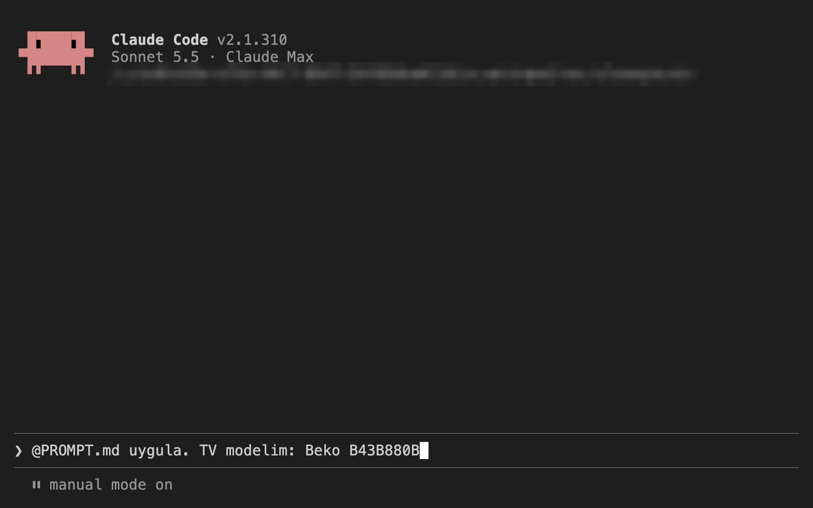
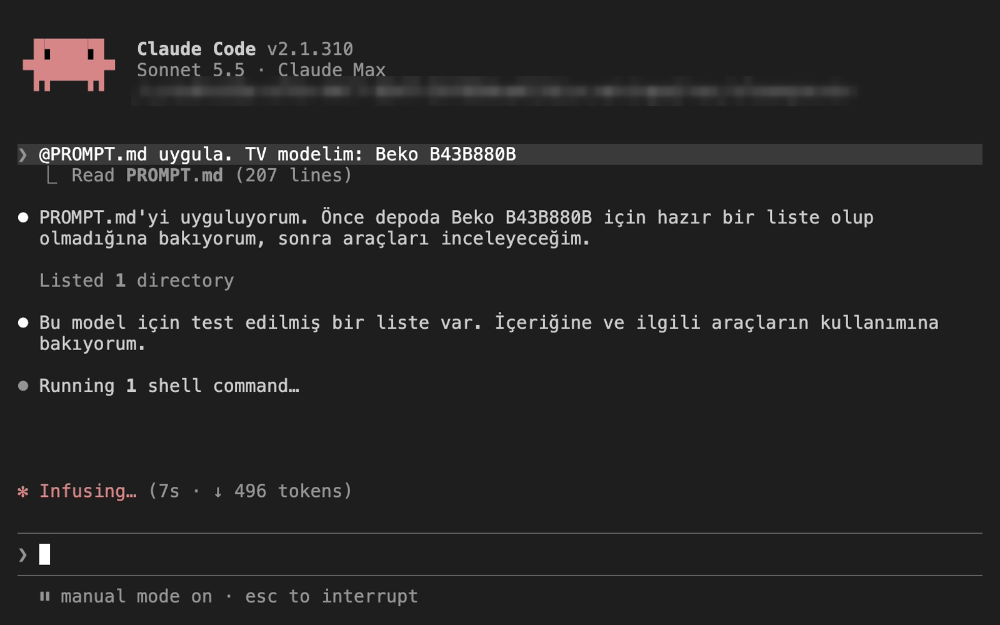
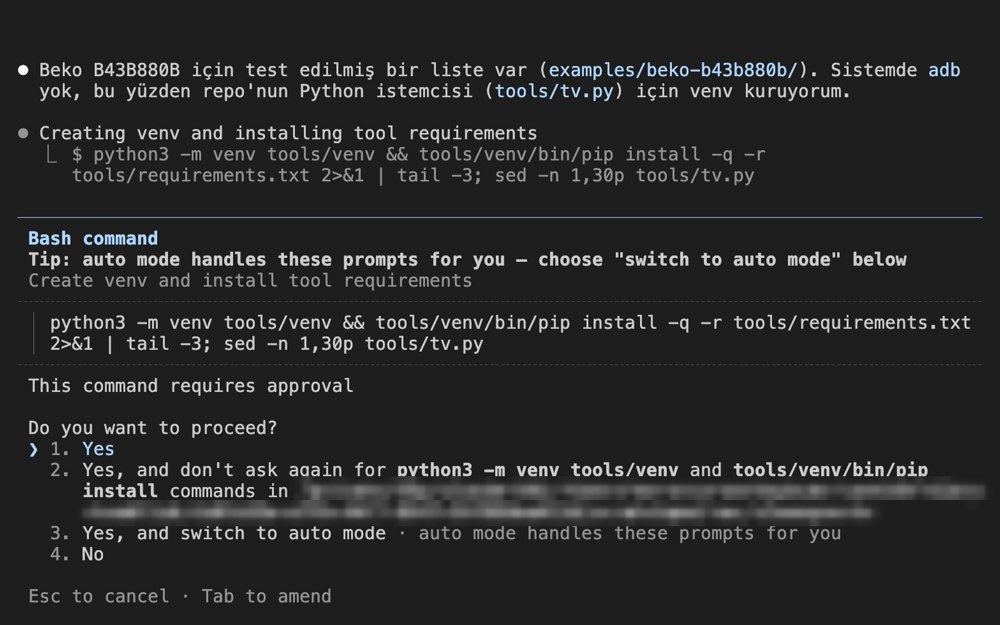

# Bizim kaydımız: Beko B43B880B, 24 Ekim 2026

Reel'deki Claude Code ekranları bu kayıttan. Promptu verip Claude'un ilk dakikada ne yaptığını gördük, ilk kurulum komutunda durduk. TV'ye bağlanmadık.

## Kurulum

- CleanYourTV reposunun yeni ve temiz bir kopyası (`git clone --depth 1`).
- Claude Code 2.1.310, Sonnet 5.5, varsayılan izin modu ("manual mode on").
- Kaydı temiz tutmak için kendi ayarlarımızı, hook'larımızı ve MCP sunucularımızı kapattık:

```bash
claude --model sonnet --setting-sources project --strict-mcp-config --permission-mode default
```

Sen bunlarla uğraşma, `claude --permission-mode default` yeterli.

## Ne oldu

1. Promptu yazdık: `@PROMPT.md uygula. TV modelim: Beko B43B880B`

   

2. Claude `PROMPT.md` dosyasını okudu (o gün 207 satırdı, 28 Ekim'de 235) ve Türkçe cevap verdi:

   > PROMPT.md'yi uyguluyorum. Önce depoda Beko B43B880B için hazır bir liste olup olmadığına bakıyorum, sonra araçları inceleyeceğim.

   > Bu model için test edilmiş bir liste var. İçeriğine ve ilgili araçların kullanımına bakıyorum.

   

3. Listeye ve araçlara baktı, bilgisayarda `adb` olmadığını gördü:

   > Beko B43B880B için test edilmiş bir liste var (examples/beko-b43b880b/). Sistemde adb yok, bu yüzden repo'nun Python istemcisi (tools/tv.py) için venv kuruyorum.

   Sonra şu komut için izin istedi:

   ```
   python3 -m venv tools/venv && tools/venv/bin/pip install -q -r tools/requirements.txt 2>&1 | tail -3; sed -n 1,30p tools/tv.py
   ```

   

4. Esc'ye basıp komutu reddettik. Kayıt burada bitti.

Bu ilk dakikada dosya okuma ve klasör listeleme gibi adımlar izin sormadan çalıştı. İlk izin sorusu kurulum komutunda geldi.

## Sonrası

- Kayıttan sonra kopyayı kontrol ettik: hiçbir dosya değişmemişti, `tools/venv` klasörü oluşmamıştı.
- TV'ye bağlanmadık, hiçbir paket kapatılmadı, geri alma denenmedi.
- Rehberdeki sonraki adımlar CleanYourTV'nin `README.md` ve `PROMPT.md` dosyalarından.

Kendi denemende bu soruya "1. Yes" diyerek devam edersin. Claude sıradaki adımda TV'ye bağlanmaya çalışır ve TV ekranında izin sorusu çıkar.

## Ekran görüntüleri hakkında

Üç görüntü de VHS ile yapılmış ekran kaydından alındı. Üst satırdaki ve izin seçeneğindeki klasör yolunu bulanıklaştırdık, gerisi olduğu gibi.
